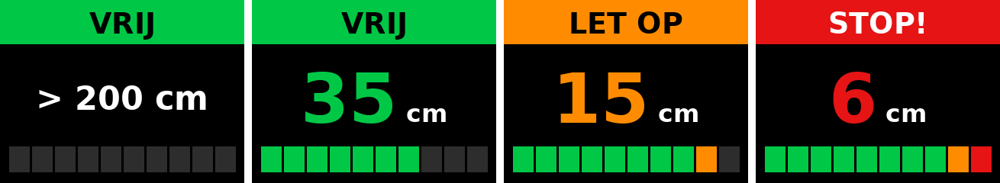

# Achteruitrij-parkeersensor met Raspberry Pi

Een parkeersensor zoals in een auto: een ultrasone sensor meet de afstand tot
een obstakel achter de auto. Drie LEDs, een buzzer en een 2.0" kleurendisplay
(GMT020-02-7P) laten zien hoe dichtbij je bent.



| Afstand           | LED       | Buzzer                          | Display           |
|-------------------|-----------|---------------------------------|-------------------|
| meer dan 50 cm    | 🟢 groen  | stil                            | `VRIJ`            |
| 20 – 50 cm        | 🟢 groen  | langzaam piepen                 | `VRIJ`            |
| 10 – 20 cm        | 🟠 oranje | snel piepen (sneller = dichter) | `LET OP`          |
| 10 cm of minder   | 🔴 rood   | continu piepen                  | `STOP!`           |

Het display toont de afstand in cm in grote cijfers, met daaronder een balk die
voller wordt naarmate je dichterbij komt. Alle grenzen staan in
[`parkeersensor/config.py`](parkeersensor/config.py) en kun je daar aanpassen.

## Onderdelen

- Raspberry Pi (3, 4, 5 of Zero 2 W) met Raspberry Pi OS
- HC-SR04 ultrasone afstandssensor
- 3 LEDs: groen, oranje (of geel) en rood
- 3 weerstanden van 220 Ω (voor de LEDs)
- Actieve buzzer, 5V of 3,3V (een actieve buzzer piept zelf als hij spanning krijgt)
- **GMT020-02-7P Ver. 1.3**: 2.0" IPS kleurendisplay, 240x320, ST7789-chip, SPI, 7 pinnen
- Weerstanden van 1 kΩ en 2 kΩ (spanningsdeler voor de ECHO-pin)
- Breadboard en jumperdraden

Heb je in plaats daarvan een 16x2 LCD met I2C-rugje? Dat kan ook, zie
[Ander display: 16x2 LCD](#ander-display-16x2-lcd).

## Aansluitschema

> ⚠️ **Belangrijk:** de ECHO-pin van de HC-SR04 geeft 5V. De GPIO-pinnen van de
> Pi kunnen maar 3,3V aan. Gebruik daarom altijd de spanningsdeler hieronder,
> anders kan je Pi kapotgaan.

| Onderdeel         | Pin onderdeel | Raspberry Pi                   | Fysieke pin |
|-------------------|---------------|--------------------------------|-------------|
| HC-SR04           | VCC           | 5V                             | 2           |
| HC-SR04           | GND           | GND                            | 6           |
| HC-SR04           | TRIG          | GPIO 23                        | 16          |
| HC-SR04           | ECHO          | GPIO 24 **via spanningsdeler** | 18          |
| LED groen         | + (lange poot)| GPIO 17 (via 220 Ω)            | 11          |
| LED oranje        | + (lange poot)| GPIO 27 (via 220 Ω)            | 13          |
| LED rood          | + (lange poot)| GPIO 22 (via 220 Ω)            | 15          |
| LEDs              | − (korte poot)| GND                            | 9 / 14      |
| Buzzer            | +             | GPIO 18                        | 12          |
| Buzzer            | −             | GND                            | 20          |

### Display GMT020-02-7P

De pinnen staan meestal in deze volgorde op het display (controleer de opdruk):
`GND VCC SCL SDA RES DC BLK`.

| Display | Betekenis                    | Raspberry Pi          | Fysieke pin |
|---------|------------------------------|-----------------------|-------------|
| GND     | massa                        | GND                   | 25          |
| VCC     | voeding                      | **3,3V**              | 17          |
| SCL     | SPI-klok                     | GPIO 11 (SPI0 SCLK)   | 23          |
| SDA     | SPI-data                     | GPIO 10 (SPI0 MOSI)   | 19          |
| RES     | reset                        | GPIO 5                | 29          |
| DC      | data/commando                | GPIO 25               | 22          |
| BLK     | achtergrondverlichting       | GPIO 6                | 31          |

- SCL en SDA heten zo op het display, maar het is **SPI, geen I2C**. Ze moeten
  echt op pin 23 en 19.
- Dit display heeft geen CS-pin. De software zet SPI daarom in mode 3; zonder
  dat blijft het scherm wit.
- Laat GPIO 8 (pin 24, CE0) vrij: de Pi gebruikt die pin voor SPI, ook al hangt
  er niets aan.
- BLK mag je ook direct aan 3,3V hangen. Zet dan `TFT_BLK_PIN = None` in
  `config.py`.

### Spanningsdeler voor de ECHO-pin

```
HC-SR04 ECHO ──[ 1 kΩ ]──┬──────── GPIO 24 (pin 18)
                         │
                      [ 2 kΩ ]
                         │
                        GND
```

5V × 2k / (1k + 2k) ≈ 3,3V. Heb je geen 2 kΩ? Twee weerstanden van 1 kΩ in serie werken ook.

### Buzzer

Een actieve buzzer trekt meestal weinig stroom en kan direct op een GPIO-pin. Is
je buzzer luider of heeft hij meer dan ~15 mA nodig, stuur hem dan aan via een
NPN-transistor (bijv. BC547 of 2N2222) met 1 kΩ op de basis.

## Installatie op de Raspberry Pi

1. **SPI aanzetten** (voor het display):

   ```bash
   sudo raspi-config   # Interface Options → SPI → Enable
   sudo reboot
   ```

   Controleer daarna of `/dev/spidev0.0` bestaat: `ls /dev/spidev*`

2. **Project ophalen en installeren:**

   ```bash
   cd ~
   git clone https://github.com/jeroenkoomen1975/achteruitrijcamera_RPI.git
   cd achteruitrijcamera_RPI
   sudo apt install -y python3-gpiozero python3-lgpio python3-spidev \
                       python3-pil python3-numpy fonts-dejavu-core
   python3 -m venv --system-site-packages .venv
   ```

   (Alleen voor het 16x2 LCD heb je ook `.venv/bin/pip install -r requirements.txt` nodig.)

3. **Starten:**

   ```bash
   .venv/bin/python -m parkeersensor.main
   ```

   Stoppen met `Ctrl+C`. De LEDs, de buzzer en het display gaan dan uit.

### Automatisch starten bij het opstarten

```bash
sudo cp systemd/parkeersensor.service /etc/systemd/system/
sudo systemctl daemon-reload
sudo systemctl enable --now parkeersensor
```

Gebruik je een andere gebruikersnaam dan `pi`, pas dan `User` en de paden aan in
`systemd/parkeersensor.service`. Logboek bekijken: `journalctl -u parkeersensor -f`.

Tip voor in de auto: sluit de Pi aan op een USB-lader die op de
achteruitrijlamp is aangesloten. Dan start de sensor alleen als je in z'n
achteruit zet.

## Ander display: 16x2 LCD

Een 16x2 LCD met I2C-rugje (PCF8574) wordt ook ondersteund:

1. Zet in `parkeersensor/config.py`: `DISPLAY_TYPE = "lcd1602"`.
2. Sluit aan: VCC → 5V (pin 4), GND → pin 6, SDA → GPIO 2 (pin 3), SCL → GPIO 3 (pin 5).
3. Zet I2C aan met `sudo raspi-config` (Interface Options → I2C) en installeer
   `.venv/bin/pip install -r requirements.txt`.
4. Controleer het adres met `i2cdetect -y 1` (`27` of `3f`) en zet dat in
   `LCD_I2C_ADRES`.

## Testen zonder Raspberry Pi

De simulatie laat een auto langzaam naar een muur toe rijden en weer weg. In de
terminal zie je de LED-kleur, de afstand en wanneer de buzzer piept. Met
`--scherm-png` wordt ook het beeld van het kleurendisplay als plaatje opgeslagen:

```bash
pip install pillow numpy
python3 -m parkeersensor.main --simulatie --scherm-png scherm.png
```

Unittests (zones, piepritme, schermopbouw en de displaydriver met nep-SPI):

```bash
python3 -m unittest -v
```

## Hoe werkt het?

- `parkeersensor/config.py`: pinnen, afstandsgrenzen, display- en piepinstellingen.
- `parkeersensor/logica.py`: bepaalt de zone, het piepritme en de tekst.
- `parkeersensor/scherm.py`: tekent het beeld voor het kleurendisplay met Pillow.
- `parkeersensor/st7789.py`: kleine driver die het beeld via SPI naar de
  GMT020-02 stuurt.
- `parkeersensor/main.py`: stuurt de hardware aan. De sensor meet 10 keer per
  seconde. Het programma neemt de mediaan van de laatste 3 metingen, zodat
  losse foute metingen genegeerd worden. Het display wordt alleen opnieuw
  getekend als de afstand een hele cm verandert. De buzzer piept zonder
  `sleep` ertussen, dus het meten gaat door terwijl hij piept.

## Problemen oplossen

| Probleem                              | Oplossing                                                          |
|---------------------------------------|--------------------------------------------------------------------|
| Display blijft wit                    | SPI aan? SCL op pin 23 en SDA op pin 19? RES en DC niet omgewisseld? |
| Display blijft zwart                  | BLK aangesloten (GPIO 6 of 3,3V)?                                  |
| Kleuren zijn negatief (zwart is wit)  | Zet `TFT_INVERT = False` in `config.py`.                           |
| Rood en blauw omgewisseld             | Zet `TFT_BGR = True`.                                              |
| Beeld staat ondersteboven of gedraaid | Zet `TFT_ROTATIE = 270` (of 0/180 voor staand).                    |
| Strepen of rommel op het scherm       | Kortere draadjes, of `TFT_SPI_SNELHEID_HZ = 20_000_000`.           |
| `display 'st7789' werkt niet`         | Lees de foutmelding erachter; meestal staat SPI niet aan.          |
| Afstand staat altijd op maximum       | TRIG en ECHO omgewisseld? Spanningsdeler goed aangesloten?         |
| Afstand springt heen en weer          | Sensor recht naar achteren richten, zet `GEMIDDELDE_VAN` op 5.     |
| Buzzer piept niet                     | Is het een passieve buzzer? Die heeft een toon nodig; gebruik een actieve buzzer. |
