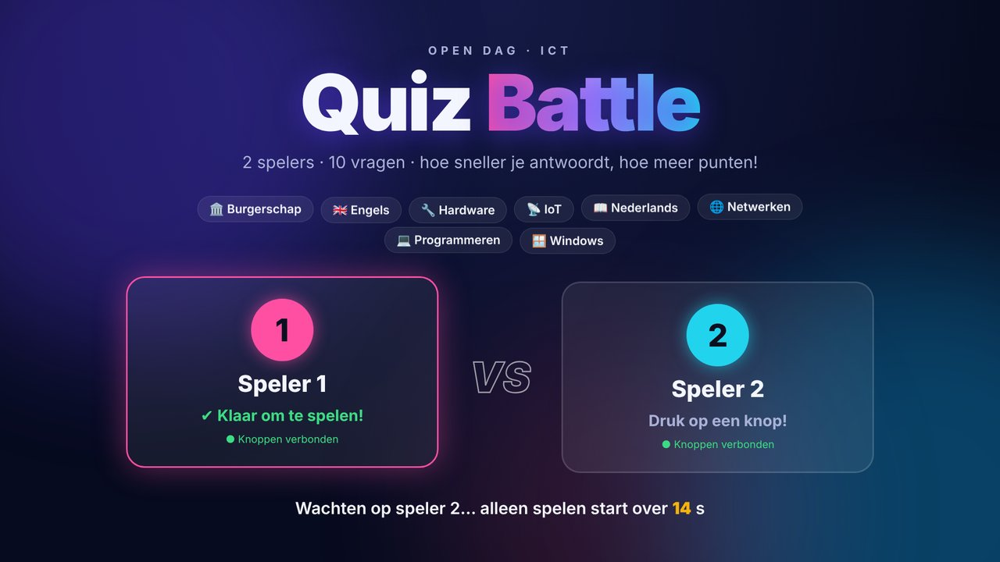
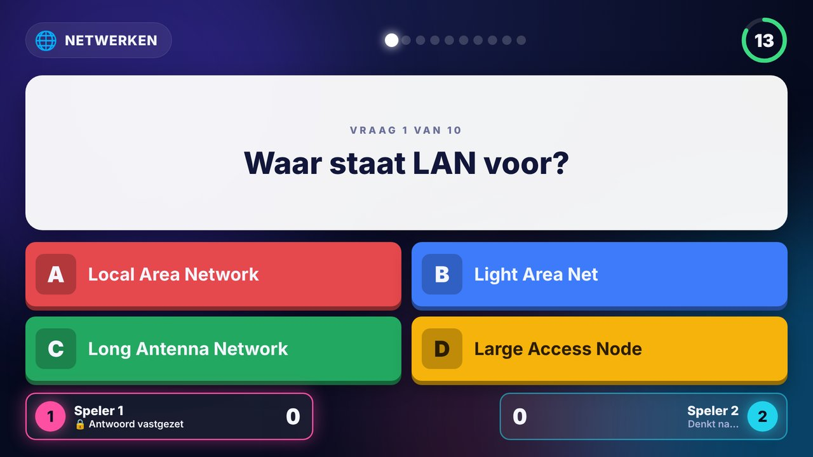
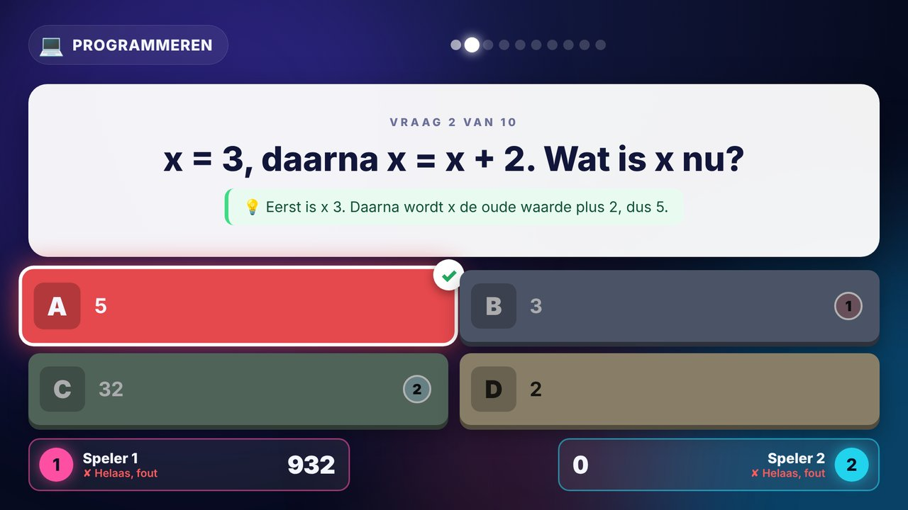
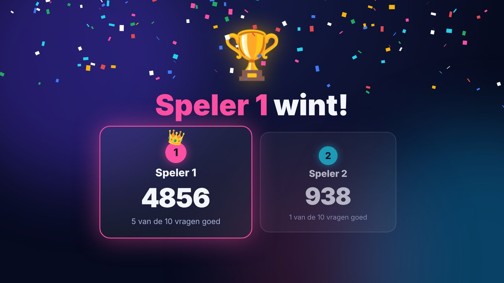

# ICT Quiz Battle: 2 spelers, arcade buttons, Raspberry Pi 5

Een quizspel voor open dagen: twee (toekomstige) studenten spelen tegen elkaar
met echte arcade buttons. Elke speler heeft een eigen knoppenkast met een
ESP32 en 4 gekleurde knoppen (A rood, B blauw, C groen, D geel). Een
Raspberry Pi 5 is de server en laat de quiz zien op een tv of beamer.

- **10 vragen** per spel, uit 8 categorieën: programmeren, IoT, netwerken,
  burgerschap, Nederlands, Engels, Windows en hardware (72 vragen in totaal)
- Elke categorie komt minstens één keer voor, en de antwoorden staan elke keer
  in een andere volgorde
- **Snelheid telt:** een goed antwoord levert 500 punten op, plus maximaal 500
  extra punten als je snel antwoordt
- Na elke vraag zie je het goede antwoord, wie wat koos, en een korte **uitleg**
- Is er geen tegenstander? Na 15 seconden wachten speel je alleen
- De lampjes in de knoppen laten zien wat je kunt doen (knipperen = druk om mee
  te doen, je gekozen knop blijft branden, het goede antwoord knippert)

| Lobby | Vraag |
|---|---|
|  |  |
| **Uitslag met uitleg** | **Winnaar** |
|  |  |

## Hoe werkt het?

```
 ┌───────────────┐      wifi (UDP)       ┌──────────────────────┐   HDMI   ┌──────────┐
 │ ESP32 speler 1│ ───── BTN / HELLO ──► │   Raspberry Pi 5     │ ───────► │ tv /     │
 │ 4 arcade btns │ ◄──── ACK / LED ───── │  quizserver (Python) │          │ beamer   │
 └───────────────┘                       │                      │          └──────────┘
 ┌───────────────┐                       │  spelregels + vragen │
 │ ESP32 speler 2│ ◄───────────────────► │  webpagina :8080     │ ◄── Chromium (kiosk)
 └───────────────┘                       └──────────────────────┘     via WebSocket
```

1. De ESP32 stuurt bij elke druk een klein UDP-bericht (`BTN 1 2 1234` = speler
   1, knop C, drukvolgnummer 1234). Komt er geen bevestiging (`ACK`), dan stuurt
   hij het opnieuw. UDP is gekozen omdat het snel is: het gaat om milliseconden.
2. De **server** op de Pi bepaalt alles: wie er meedoet, welke vraag er is,
   wie het eerst antwoordde en hoeveel punten dat oplevert. De tijd wordt op de
   Pi gemeten, dus beide spelers worden eerlijk behandeld.
3. Het **scherm** is een webpagina die via een WebSocket live updates krijgt.
4. De server stuurt de knoppenkasten terug welke lampjes aan moeten (`LED 1B00`).

De ESP32's vinden de Pi vanzelf (via een broadcast); je hoeft geen IP-adres in
te stellen.

## Onderdelen

Per knoppenkast (2x):

- ESP32 DevKit (bijvoorbeeld ESP32-WROOM-32 DevKitC)
- 4 arcade buttons van 30 mm, liefst met ingebouwde led (5 V-uitvoering), in
  rood, blauw, groen en geel
- Optioneel voor de lampjes: 1 ULN2803A (of 4 NPN-transistors zoals de BC547
  met 1 kΩ basisweerstand)
- Behuizing (MDF of 3D-geprint), draadjes, USB-kabel of powerbank

Voor de server:

- Raspberry Pi 5 met Raspberry Pi OS (Bookworm of nieuwer, met bureaublad)
- Tv of beamer met HDMI (micro-HDMI-kabel voor de Pi 5)
- Optioneel: speakers voor de geluidseffecten

## Aansluiten van een knoppenkast

Een arcade button heeft een microswitch met 2 of 3 lipjes (COM, NO, NC) en,
bij een verlichte knop, 2 losse lipjes voor de led (+ en −).

| Knop       | Microswitch COM | Microswitch NO | Led (via ULN2803) |
|------------|-----------------|----------------|-------------------|
| A (rood)   | GND             | GPIO 32        | GPIO 21           |
| B (blauw)  | GND             | GPIO 33        | GPIO 22           |
| C (groen)  | GND             | GPIO 25        | GPIO 23           |
| D (geel)   | GND             | GPIO 26        | GPIO 27           |

De knoppen hebben geen weerstand nodig: de ESP32 gebruikt zijn interne pull-up.

**Lampjes (5 V-leds in de knoppen):** een GPIO-pin geeft maar 3,3 V en weinig
stroom, daarom schakel je de leds met een ULN2803:

```
 ESP32 GPIO 21 ──► ULN2803 IN1      ULN2803 OUT1 ──► led− van knop A
 ESP32 GPIO 22 ──► ULN2803 IN2      ULN2803 OUT2 ──► led− van knop B
 ESP32 GPIO 23 ──► ULN2803 IN3      ULN2803 OUT3 ──► led− van knop C
 ESP32 GPIO 27 ──► ULN2803 IN4      ULN2803 OUT4 ──► led− van knop D
 ESP32 GND     ──► ULN2803 GND      ESP32 5V/VIN ──► led+ van alle knoppen
```

Heb je 12 V-leds? Sluit led+ dan aan op een 12 V-voeding en verbind de GND van
die voeding met de GND van de ESP32. Geen lampjes? Zet `LEDS_AANWEZIG` op `0`
in `config.h`; alles werkt dan gewoon zonder.

## Stap 1: de Raspberry Pi als wifi-hotspot (aanrader)

Op een open dag is het schoolnetwerk vaak dicht of druk. Het makkelijkst is dat
de Pi zijn eigen wifi-netwerk maakt:

```bash
sudo nmcli connection add type wifi ifname wlan0 con-name QuizNet autoconnect yes \
  ssid QuizNet mode ap ipv4.method shared \
  wifi-sec.key-mgmt wpa-psk wifi-sec.psk quiz12345 802-11-wireless.band bg
sudo nmcli connection up QuizNet
```

De Pi krijgt dan het adres `10.42.0.1` en deelt zelf IP-adressen uit aan de
ESP32's. Internet voor updates kun je dan via een netwerkkabel krijgen.

Gebruik je liever een bestaand netwerk? Vul dan in `config.h` dat netwerk in.
Werkt het automatisch zoeken daar niet (sommige netwerken blokkeren
broadcasts), vul dan ook `SERVER_IP` in met het IP-adres van de Pi
(`hostname -I`).

## Stap 2: de quizserver installeren

```bash
cd ~
git clone <url-van-deze-repo> achteruitrijcamera_RPI
cd achteruitrijcamera_RPI/quiz
python3 -m venv .venv
.venv/bin/pip install -r requirements.txt
sudo apt install -y fonts-noto-color-emoji   # voor de iconen op het scherm

.venv/bin/python -m quizserver               # starten om te testen
```

Open op de Pi `http://localhost:8080`, of vanaf een laptop in hetzelfde netwerk
`http://10.42.0.1:8080`.

### Automatisch starten bij het opstarten

```bash
# de server als achtergronddienst
sudo cp systemd/quiz-server.service /etc/systemd/system/
sudo systemctl daemon-reload
sudo systemctl enable --now quiz-server

# het scherm schermvullend openen na het inloggen
mkdir -p ~/.config/autostart
cp kiosk/quiz-kiosk.desktop ~/.config/autostart/
```

Staat je gebruiker niet op `pi` of de map ergens anders? Pas dan de paden aan in
`systemd/quiz-server.service` en `kiosk/quiz-kiosk.desktop`. Zet ook
automatisch inloggen aan (`sudo raspi-config` → System Options → Boot / Auto
Login → Desktop Autologin). Na een herstart staat de quiz dan vanzelf klaar.

Logboek bekijken: `journalctl -u quiz-server -f`

## Stap 3: de ESP32's programmeren

1. Installeer de [Arduino IDE](https://www.arduino.cc/en/software) en voeg het
   ESP32-pakket toe: *Bestand → Voorkeuren → Additional boards manager URLs*:
   `https://espressif.github.io/arduino-esp32/package_esp32_index.json`,
   daarna in de *Boards Manager* "esp32 by Espressif Systems" installeren.
2. Open `esp32/quizknoppen/quizknoppen.ino`.
3. Pas `config.h` aan: wifi-naam en -wachtwoord, en **`SPELER_NUMMER`**:
   `1` voor de linker kast, `2` voor de rechter kast.
4. Kies board **ESP32 Dev Module** en de juiste poort, en klik op *Upload*.
5. Doe hetzelfde voor de tweede ESP32, met `SPELER_NUMMER 2`.

Open de *Serial Monitor* (115200 baud) om te zien wat er gebeurt. Wat de
lampjes betekenen:

| Lampjes              | Betekenis                                   |
|----------------------|---------------------------------------------|
| looplicht A→B→C→D    | zoekt wifi of de quizserver                 |
| alle 4 knipperen     | lobby: druk op een knop om mee te doen      |
| alle 4 aan           | klaar / vraag loopt, kies je antwoord       |
| één knop aan         | jouw gekozen antwoord (staat vast)          |
| één knop knippert    | dit was het goede antwoord                  |

Op het lobbyscherm zie je per speler "● Knoppen verbonden" zodra een kast
contact heeft.

## Spelen

1. Beide spelers drukken op een willekeurige knop → "Klaar om te spelen!"
2. Na "3, 2, 1" verschijnt de eerste vraag. Je hebt 15 seconden.
3. Druk op de knop met de kleur van jouw antwoord. **Je eerste keuze telt**,
   je kunt niet meer wisselen.
4. Hebben beide spelers geantwoord (of is de tijd om), dan zie je het goede
   antwoord, wie wat koos en een korte uitleg.
5. Na 10 vragen volgt de winnaar met confetti. Druk op een knop om opnieuw te
   spelen; na 30 seconden gaat het scherm vanzelf terug naar de lobby.

**Toetsenbord** (handig om te testen zonder knoppen, of als reserve):

| Toets         | Actie                       |
|---------------|-----------------------------|
| `1` `2` `3` `4` | speler 1: A B C D          |
| `7` `8` `9` `0` | speler 2: A B C D          |
| `Esc`         | spel afbreken, terug naar de lobby |
| `F`           | volledig scherm aan/uit     |
| `M`           | geluid aan/uit              |
| `H`           | toetsenhulp tonen           |

## Vragen aanpassen of toevoegen

Alle vragen staan in [`quizserver/vragen.json`](quizserver/vragen.json):

```json
{"categorie": "netwerken", "vraag": "Welk commando test of een ander apparaat bereikbaar is?",
 "antwoorden": ["ping", "copy", "format", "dir"], "goed": 0,
 "uitleg": "Met ping stuur je een klein berichtje en kijk je of er antwoord terugkomt."}
```

- Elke vraag heeft precies 4 antwoorden; `goed` is de index van het goede
  antwoord (0 = de eerste). De volgorde wordt tijdens het spel toch geschud.
- Houd antwoorden kort (tot ongeveer 35 tekens), dan passen ze groot op het scherm.
- Gebruik geen antwoorden als "alle bovenstaande", want de volgorde verandert.
- Een nieuwe categorie voeg je toe onder `categorieen`, met een naam en een emoji.

Na een wijziging: `sudo systemctl restart quiz-server`. Klopt er iets niet in
het bestand, dan start de server niet en zie je in het logboek welke vraag fout is.

Tijden en punten (bedenktijd, aantal vragen, enzovoort) pas je aan in
[`quizserver/config.py`](quizserver/config.py).

## Testen

```bash
.venv/bin/pip install pytest
.venv/bin/python -m pytest
```

De tests controleren de spelregels (punten, tijden, solo, gelijkspel, lampjes),
de vragenbank en het UDP-protocol. Je kunt een knoppenkast ook nadoen vanaf een
laptop:

```bash
python3 -c "import socket; s=socket.socket(socket.AF_INET, socket.SOCK_DGRAM); s.sendto(b'BTN 1 0 1', ('10.42.0.1', 4210))"
```

## Problemen oplossen

| Probleem | Oplossing |
|---|---|
| Lampjes blijven rondlopen | De ESP32 vindt de server niet. Klopt de wifi-naam? Draait de server (`systemctl status quiz-server`)? Vul anders `SERVER_IP` in `config.h` in. |
| "Knoppen niet verbonden" op het scherm | Zie hierboven. Kijk ook in de Serial Monitor van de ESP32. |
| Beide kasten besturen dezelfde speler | Je bent vergeten `SPELER_NUMMER` te veranderen bij de tweede ESP32. |
| Knop reageert dubbel of niet | Controleer of de draad op **NO** (normally open) zit, niet op NC. |
| Geen geluid | Kies het juiste audio-apparaat (HDMI) via het luidsprekericoon op het bureaublad. Druk op `M` als het geluid uit staat. |
| Vierkantjes in plaats van iconen | `sudo apt install fonts-noto-color-emoji` en herstart. |
| Scherm is niet volledig | Druk op `F`, of controleer of `start_kiosk.sh` wordt gestart. |

## Mappen

```
quiz/
├── quizserver/          de server (Python, aiohttp)
│   ├── __main__.py      webserver, WebSocket en UDP
│   ├── spel.py          spelregels: fases, punten, lampjes
│   ├── vragen.py        vragen inlezen en kiezen
│   ├── vragen.json      de vragenbank
│   ├── protocol.py      berichten tussen ESP32 en server
│   ├── config.py        tijden, punten en poorten
│   └── static/          het quizscherm (HTML, CSS, JavaScript)
├── esp32/quizknoppen/   Arduino-code voor de knoppenkasten
├── systemd/             automatisch starten van de server
├── kiosk/               automatisch openen van het scherm
└── tests/               pytest-tests
```
