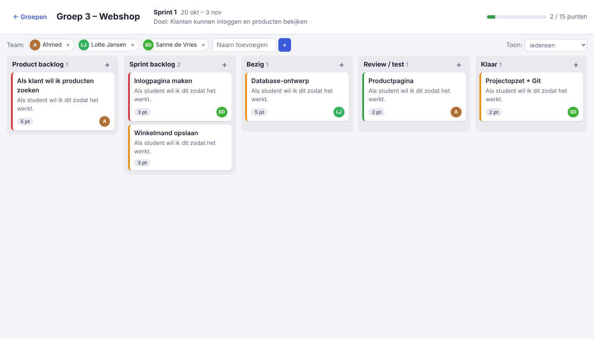

# Scrumboard voor studentengroepen

Een eenvoudige website waarop elke studentengroep een eigen scrumboard heeft.
Draait op een Raspberry Pi (of elke computer met Python 3.9+) en heeft **geen
extra pakketten** nodig: alleen de standaardbibliotheek en SQLite.



## Wat kan het?

- **Groepen**: iedere groep maakt een eigen bord aan, beveiligd met een pincode
  (4–8 cijfers). Na 5 foute pogingen moet je een minuut wachten.
- **Vijf kolommen**: Product backlog → Sprint backlog → Bezig → Review / test → Klaar.
- **Kaartjes** (user stories) met titel, omschrijving / acceptatiecriteria,
  storypoints, prioriteit (kleurstreep) en wie eraan werkt.
- **Slepen** van kaartjes tussen en binnen kolommen. Op een telefoon of tablet
  verplaats je een kaartje via het veld *Kolom* in het bewerkvenster.
- **Sprint**: naam, sprintdoel en start-/einddatum, met een voortgangsbalk
  (storypoints in *Klaar* t.o.v. alle punten in de sprint).
  Aan het eind van de sprint kun je de kolom *Klaar* in één keer leegmaken.
- **Team**: voeg groepsleden toe en filter het bord op één persoon.
- **Live**: het bord ververst elke paar seconden, zodat iedereen in de groep
  dezelfde stand ziet.
- Werkt op laptop en telefoon, in licht en donker thema.

## Starten

```bash
cd ~/achteruitrijcamera_RPI
python3 -m scrumboard.server --poort 8000 --database scrumboard.db
```

Open daarna in de browser `http://<ip-adres-van-de-pi>:8000`
(het IP-adres vind je met `hostname -I`). Alle groepen en kaartjes staan in
het bestand `scrumboard.db`; maak daar af en toe een kopie van.

### Automatisch starten

```bash
sudo cp systemd/scrumboard.service /etc/systemd/system/
sudo systemctl enable --now scrumboard
```

## Opbouw

| Bestand                   | Wat                                              |
|---------------------------|--------------------------------------------------|
| `server.py`               | Webserver en JSON-API (`/api/...`)               |
| `opslag.py`               | Database, pincodes, controle van invoer          |
| `static/index.html`       | De pagina                                        |
| `static/app.js`           | Bord tekenen, slepen, dialogen, verversen        |
| `static/style.css`        | Opmaak                                           |

Tests: `python3 -m unittest tests.test_scrumboard`

> De pincode is bedoeld om groepen uit elkaars bord te houden, niet als echte
> beveiliging. Zet de server niet zonder extra beveiliging (HTTPS, wachtwoord)
> open op internet; gebruik hem op het school- of thuisnetwerk.
