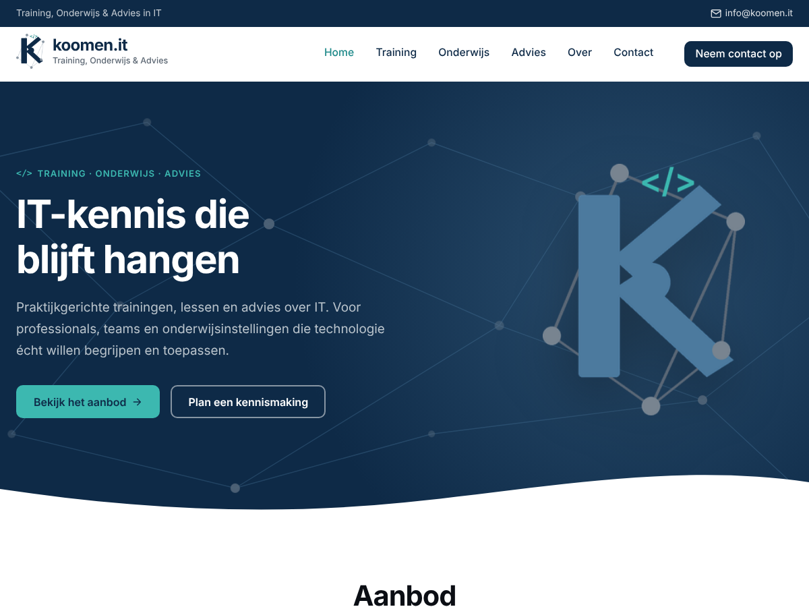

# Koomen.IT – WordPress portfolio-thema

Portfolio-thema in de huisstijl van **koomen.it**: helder blauw, donker leisteen en het
netwerkmotief uit het logo. Gemaakt om embedded projecten, websites en software met
**ESP32, Arduino en Raspberry Pi** te laten zien.



## Installeren

1. Maak een zip van de map: `cd wordpress-theme && zip -r koomenit.zip koomenit`
2. Ga in WordPress naar **Weergave → Thema's → Nieuw thema toevoegen → Thema uploaden**.
3. Upload `koomenit.zip` en klik op **Activeren**.

Bij het activeren (en na elke update van het thema) maakt het thema automatisch de
platforms *ESP32*, *Arduino* en *Raspberry Pi* aan, de projecttypes *Website / webinterface*,
*Sensorproject* en *Programma / software*, en de websitetypes *Bedrijfswebsite*, *Webshop*,
*Portfolio*, *Webapplicatie* en *Webinterface voor hardware*. Bestaande termen blijven staan.
De overzichten staan op `/projecten/` en `/websites/`.

Zet bij **Instellingen → Algemeen** de sitetitel op `koomen.it`: het deel na de punt (`.it`)
krijgt dan automatisch de grijze kleur uit het logo.

## Een project toevoegen

Ga in het dashboard naar **Projecten → Nieuw project**.

| Veld                       | Waar het verschijnt |
|----------------------------|---------------------|
| Titel en inhoud            | Projectpagina (gebruik gerust tabellen, codeblokken en afbeeldingen) |
| Samenvatting               | Projectkaart en onder de titel op de projectpagina |
| Projectafbeelding          | Groot op de kaart en bovenaan de projectpagina; zonder afbeelding toont de kaart het logo of een platformicoon |
| Logo (projectgegevens)     | Klein vóór de titel op de kaart en de projectpagina |
| Platform                   | Badges, filterknoppen en de platformkaarten op de homepage |
| Projecttype                | Label op de kaart en bij de projectgegevens |
| Technieken                 | Labels op de kaart (C++, Python, MQTT, BME280, …) |
| Projectgegevens (zijbalk)  | Status, jaar, GitHub-link, demo-link en de hardwarelijst |

## Een website toevoegen

Ga in het dashboard naar **Websites → Nieuwe website**. Dit werkt hetzelfde als een project.

| Veld                       | Waar het verschijnt |
|----------------------------|---------------------|
| Titel, inhoud, samenvatting | Websitepagina en websitekaart |
| Schermafbeelding (uitgelichte afbeelding) | Groot in een browservenster met adresbalk; zonder schermafbeelding toont de kaart het logo groot, of een schets van een webpagina |
| Logo (websitegegevens)     | Klein vóór de titel op de kaart en de websitepagina |
| Websitetype                | Filterknoppen en label op de kaart |
| Technieken                 | Labels (WordPress, WooCommerce, PHP, …); dezelfde lijst als bij projecten |
| Websitegegevens (zijbalk)  | Webadres, opdrachtgever, rol, status (live, in ontwikkeling, in beheer, archief), jaar en optioneel GitHub |

De knop *Bezoek website* verschijnt alleen als er een webadres is en de status niet *Archief* is.

Projecten en websites staan als liggende kaarten onder elkaar: afbeelding links, logo, tekst en
de knoppen *Lees meer* en *Bezoek website* (of *Code op GitHub*) rechts. De hele kaart is klikbaar.
De uitgelichte afbeelding staat standaard in zijn geheel in beeld (passend, op wit), dus een
logo wordt nooit bijgesneden. Wil je dat een schermafbeelding het vlak vult, kies dan per project
of website bij *Weergave uitgelichte afbeelding* voor *Vullend*. Een logo met transparante
achtergrond (PNG of SVG) staat het mooist.

## Blog

Maak twee lege pagina's, *Home* en *Blog*, en kies ze bij **Instellingen → Lezen** als homepage en
berichtenpagina. De homepage blijft de secties van het thema tonen; `/blog/` toont alle berichten.

In **Weergave → Customizer → Koomen.IT thema-opties → Blogpagina en berichten** stel je in:
raster- of lijstweergave, het nieuwste bericht groot bovenaan, filterknoppen per categorie,
leestijd, tags op de kaarten, de zijbalk (zoeken, categorieën en GitHub, of je eigen widgets),
een automatische inhoudsopgave bij berichten met 3 of meer tussenkoppen en "Meer berichten"
onder een bericht.

## Homepage aanpassen

Alles staat in **Weergave → Customizer → Koomen.IT thema-opties**. Elke sectie kan aan of uit.

| Sectie              | Opties |
|---------------------|--------|
| Kleuren & stijl     | Blauw, lichtblauw, netwerkgrijs, donkere achtergrond, koppen, lichte achtergrond, tekst, afronding |
| Typografie          | Lettertype voor koppen en tekst |
| Header & topbalk    | Topbalk aan/uit, e-mail, telefoon, knop rechtsboven |
| Hero                | Titel, tekst, knoppen, achtergrondafbeelding en de illustratie rechts: een **codevenster** (bestandsnaam, taal Python of C++, eigen code, regelnummers, statusbalk, link naar het project, typ-animatie aan/uit), een seriële monitor, het logo of niets |
| Platforms           | Tot 4 kaarten. Heet een kaart hetzelfde als een platform, dan linkt hij automatisch naar dat platform en toont hij het aantal projecten |
| Projecten           | Titel, intro, aantal projecten, filterknoppen aan/uit |
| Websites            | Titel, intro, aantal websites, filterknoppen per websitetype aan/uit |
| Over                | Tekst, expertise, foto, knop (standaard naar GitHub) |
| Cijfers             | Tot 4 cijfers, automatisch geteld (projecten, websites, platforms, technieken) of zelf ingevuld |
| Blog                | Nieuwste berichten |
| Call-to-action      | Titel, tekst en knop |
| Footer & social     | Omschrijving, adres, GitHub, LinkedIn, YouTube, Instagram |

Verder: logo-favicon (als er geen site-icoon is ingesteld), twee menulocaties, zijbalk en drie
footer-widgetkolommen, het koomen.it-kleurenpalet in de blokeditor en een paginasjabloon
**Volledige breedte**.

## Demo

`demo/` bevat een statische weergave van de homepage, het project- en websiteoverzicht, een
project- en websitepagina, de blog (raster en lijst) en een bericht, gemaakt uit de echte
thema-templates:

```bash
php wordpress-theme/demo/render-demo.php
```

Het project *Achteruitrij-parkeersensor* en de website *koomen.it* zijn echt; alles wat met
"Voorbeeld:" begint, en de blogberichten, zijn voorbeelden.
