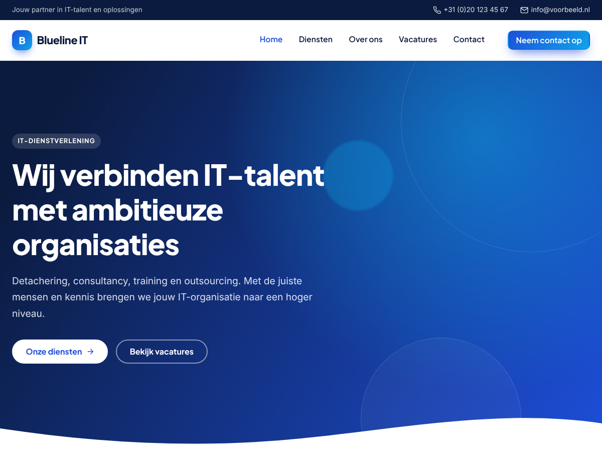

# Blueline – WordPress-thema

Modern, zakelijk WordPress-thema met een blauwe uitstraling, bedoeld voor
IT-dienstverleners (detachering, consultancy, training, outsourcing).
Vrijwel alles is aan te passen via **Weergave → Customizer → Blueline thema-opties**.



## Installeren

1. Pak de map `blueline/` in als zip: `cd wordpress-theme && zip -r blueline.zip blueline`
2. Ga in WordPress naar **Weergave → Thema's → Nieuwe toevoegen → Thema uploaden**.
3. Upload `blueline.zip` en activeer het thema.
4. Maak onder **Weergave → Menu's** een menu aan en koppel het aan *Hoofdmenu* (en eventueel *Footermenu*).

## Wat kun je aanpassen?

| Customizer-sectie   | Opties |
|---------------------|--------|
| Kleuren & stijl     | Primaire kleur, accentkleur, donkere kleur, lichte achtergrond, tekstkleur, afronding van hoeken |
| Typografie          | Lettertype voor koppen en tekst (Google Fonts) |
| Header & topbalk    | Topbalk aan/uit, tekst, telefoon, e-mail, knop rechtsboven |
| Hero                | Label, titel, tekst, twee knoppen, achtergrondafbeelding, sterkte van de blauwe overlay |
| Diensten            | Titel, intro en 4 diensten (icoon, titel, tekst, link). Laat een titel leeg om een dienst te verbergen |
| Over ons            | Titel, tekst, voordelen (één per regel), afbeelding, knop |
| Cijfers             | 4 kerncijfers met optelanimatie |
| Nieuws              | Titel en aantal berichten (laatste berichten / vacatures) |
| Call-to-action      | Titel, tekst en knop |
| Footer & social     | Omschrijving, adres, copyright, LinkedIn/Facebook/Instagram/X |

Elke homepage-sectie kan apart aan- of uitgezet worden. Daarnaast:

- Eigen logo (**Site-identiteit**), twee menulocaties, zijbalk en drie footer-widgetkolommen.
- Ondersteuning voor de blokeditor met een blauw kleurenpalet en verlopen (`theme.json`).
- Paginasjabloon **Volledige breedte** om met blokken eigen landingspagina's te bouwen.
- Responsief met mobiel menu, sticky header en subtiele scroll-animaties
  (uitgeschakeld bij `prefers-reduced-motion`).

## Demo

`demo/index.html` is een statische weergave van de homepage. Hij wordt gemaakt uit de echte
thema-templates met:

```bash
php wordpress-theme/demo/render-demo.php > wordpress-theme/demo/index.html
```
